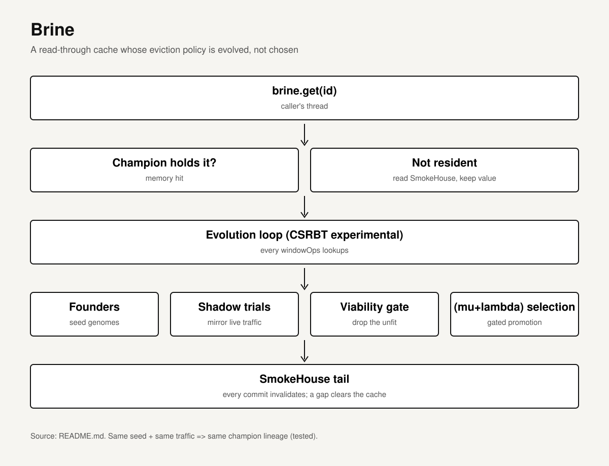

# Brine

[](https://github.com/RicheyWorks/Brine/actions/workflows/ci.yml)
[](LICENSE)
[](https://adoptium.net/)

**A read-through cache over SmokeHouse that evolves its eviction policy from the access workload.**

<p align="center"></p>

[Quickstart](#quickstart) · [API example](#api-example) · [Design & scope](#design-notes) · [Build](#build) · [Ecosystem](#the-ecosystem)

| Project | At a glance |
| --- | --- |
| Stage | Implemented Java library · source version `0.1.0` |
| Setup | Java 17+ · bundled Gradle 9.5.1 · sibling composite builds |
| Scope | Tail invalidation is asynchronous; a detected gap clears cached values. |
| Code | [Implementation](src/main/java/io/github/richeyworks/brine/Brine.java) · [Tests](src/test/java/) |

> **New here — or not a coder?** Start with the [plain-English guide to the whole ecosystem →](https://github.com/RicheyWorks/WholeHog/blob/main/ECOSYSTEM.md): what all of this is, what you'd actually use it for, and how to get it running even if you've never written a line of code.

The sixth engine of the ecosystem: the **adaptive cache** — where things soak before they're
needed. A read-through cache over [SmokeHouse](https://github.com/RicheyWorks/SmokeHouse) whose eviction policy is not
chosen but **evolved**: [CSRBT](https://github.com/RicheyWorks/CSRBT)'s experimental cache-evolution loop (founders →
shadow trials → viability gate → (μ+λ) selection → gated promotion) runs against the live
access pattern, and Brine serves values out of whatever champion currently holds the throne.

Brine consumes `csrbt-experimental` through the sibling composite build. The publication
trigger is recorded in ADR-013 §4.

## Quickstart

With Git and Java 17+ installed, run this from an empty parent folder in PowerShell. Keep the repositories side by side: the build resolves them from source.

```powershell
'CSRBT','SmokeHouse','SuperBeefSort','Brine' |
  ForEach-Object { git clone "https://github.com/RicheyWorks/$_.git" }
Set-Location Brine
.\gradlew.bat test
```

The bundled wrapper downloads Gradle and the build resolves dependencies on the first run. This command runs Brine's tests; see [Build](#build) for the full build and the existing Bash command.

## API example

```java
try (SmokeHouse<Long, Order> store = SmokeHouse.open(dir, opts);
     Brine<Long, Order> brine = Brine.over(store, 4_096, 8_192, seed)) {

    Order o = brine.get(id);      // read-through: memory if the champion holds it, store if not
    brine.champion();             // the currently serving CacheGenome
    brine.lastVerdict();          // the latest generation's one-line verdict
    brine.stats();                // gets / valueHits / storeReads / invalidations / champion
}
```

## Design notes

- **Policy and values are separate organs.** The evolution loop decides which keys deserve
  residency (over dense int ids); Brine keeps the values and trims its map to the champion's
  actual residency via the `resident(id)` seam this consumer named upstream.
- **Coherence rides the log.** One tail subscription invalidates on every committed mutation;
  a tail gap drops the whole cache — a cold start, never wrong data. The write-to-invalidation
  staleness window is bounded and documented, not hidden.
- **Caller-cadenced evolution.** Generations turn over every `windowOps` lookups on the
  caller's thread — no clock, no threads of Brine's own. Seeded: same seed + same traffic ⇒
  same champion lineage (tested).

## Measured, not asserted

`./gradlew jmh` runs `EvolvedVsFixedBenchmark`: the evolved engine (champion + shadow
mirroring + generation turnover, overhead included) against a hand-wired fixed segmented LRU
with identical read-through logic, and the no-cache floor — over a stable hot set (which
prices the evolution overhead) and a shifting one (where adapting should pay). If evolution
can't approach fixed on stable shapes or beat it on shifting ones, that verdict goes in
CLAUDE.md honestly. `build` compiles the benchmarks, so the rig can't rot.

## The ecosystem

Fourteen engines, one organism — each in its own repo, composed by nested Gradle composite
builds. New here? The [plain-English guide](https://github.com/RicheyWorks/WholeHog/blob/main/ECOSYSTEM.md)
tours all of them in plain words.

| Engine | Role |
|---|---|
| [CSRBT](https://github.com/RicheyWorks/CSRBT) | the adaptive ordered index — orders the world |
| [SuperBeefSort](https://github.com/RicheyWorks/SuperBeefSort) | the intake tract — profiles, sorts, feeds in O(n) |
| [SmokeHouse](https://github.com/RicheyWorks/SmokeHouse) | the log-structured store — durability, tail, watchers, replicas |
| [Carver](https://github.com/RicheyWorks/Carver) | the read planner — decides how to read |
| [Renderer](https://github.com/RicheyWorks/Renderer) | the materialized-view engine — folds the tail into live aggregates |
| **Brine** (this repo) | the adaptive cache — eviction policy evolved per workload |
| [PitBoss](https://github.com/RicheyWorks/PitBoss) | the fleet conductor — lag watch, re-bootstrap, the promotion runbook |
| [DryAge](https://github.com/RicheyWorks/DryAge) | the time-travel engine — as-of reads over preserved history |
| [Twine](https://github.com/RicheyWorks/Twine) | crash-atomic multi-key batches — journaled commit, idempotent replay |
| [SmokeSignal](https://github.com/RicheyWorks/SmokeSignal) | the wire — a loopback protocol face for the store |
| [Jerky](https://github.com/RicheyWorks/Jerky) | cold storage — compressed, CRC-verified backup archives |
| [WholeHog](https://github.com/RicheyWorks/WholeHog) | the integration organism — all of them, at once |
| [Rub](https://github.com/RicheyWorks/Rub) | the observability engine — tail meter + store gauge, fused into vitals |
| [Sizzle](https://github.com/RicheyWorks/Sizzle) | the chaos engine — deterministic fault injection at the write seam |

## Build

**Never set up a project like this before?** You don't need to know Java or Gradle. Open [Claude](https://claude.ai) or ChatGPT and paste:

> *“Walk me through installing Java 17 and running `RicheyWorks/Brine` from GitHub, one step at a time. I'm on Windows (or Mac) and I've never done this — keep it simple.”*

It will take you the rest of the way. The full newcomer guide lives in [ECOSYSTEM.md](https://github.com/RicheyWorks/WholeHog/blob/main/ECOSYSTEM.md).

```bash
# Requires ../SmokeHouse, ../SuperBeefSort, ../CSRBT cloned as siblings (nested composite build)
./gradlew build
```

Java 17+, Gradle 9.5.1 (bundled wrapper). Tests are seeded oracle tests (`TreeMap` store
reference) in the house style. MIT license.
